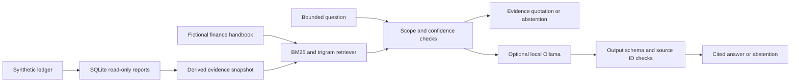

# Architecture and API

The application never sends questions to a cloud LLM, executes model-generated
SQL or gives a model tools. Its three report names are allowlisted; the SQLite
connection becomes query-only after data loading. Request-time retrieval uses
parameterized FTS queries over sanitized tokens. Evidence is loaded once into
memory; threaded read access is synchronized.

The small corpus needs neither a hosted vector database nor orchestration
framework. BM25 is the baseline; character-trigram rank fusion adds a typo-tolerant
lexical signal, not semantic embeddings. Development selection compares both.

## API

- GET `/health`: readiness and synthetic evidence-document count.
- GET `/api/reports/monthly_margin`: monthly integer-cent revenue, cost and margin.
- GET `/api/reports/contract_leakage`: below-floor line count and potential price gap.
- GET `/api/reports/data_quality`: duplicate, invalid and below-floor line counts.
- POST `/api/ask`: JSON `question` (1–500 characters), optional `mode`
  (`extractive` or `local_llm`). Response includes `answer`, `citations`,
  `abstained`, `reason`, evidence, request ID and elapsed milliseconds.

Bodies are capped at 8 KiB. The default mode returns a complete short evidence
paragraph, not a synthesized answer. The optional local mode requires an installed
model and is subject to additional latency. Errors fail closed to abstention.

## Deliberate boundaries

No document uploads, external URL ingestion, customer data, write actions, email
sending, employer connections, model-hosting service or authentication is included.
Run on loopback for local review. Before a shared deployment, add authentication,
authorization, rate limits, request budgets and deployment-specific monitoring.

The current request ID and elapsed-time fields are basic instrumentation, not an
observability platform. A production system needs centralized traces and measured
latency percentiles under concurrent load.
